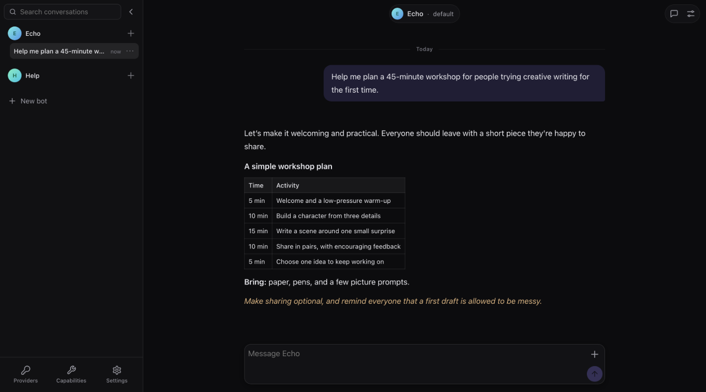
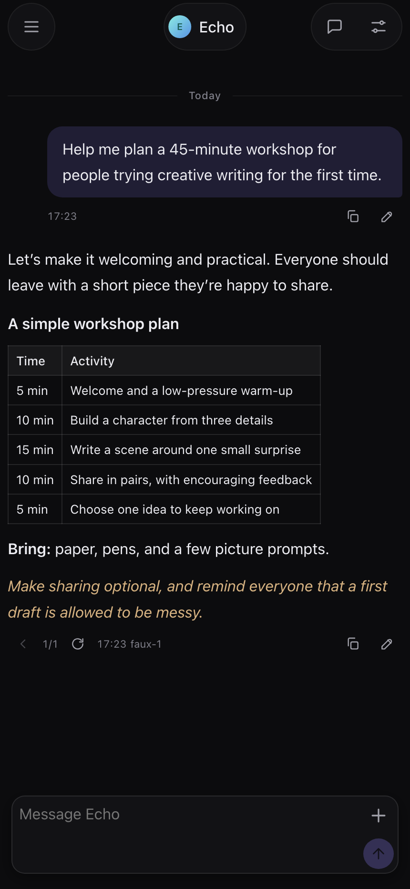
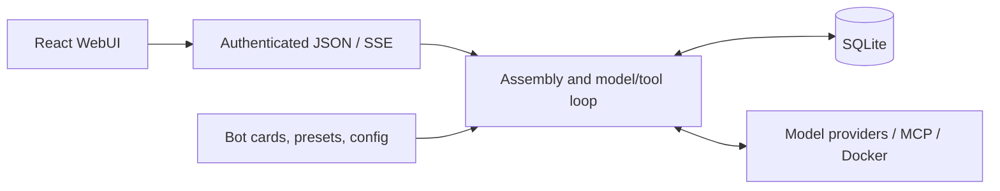

# SimpleBot

A self-hosted conversation engine with persistent context and explicit tools.

SimpleBot keeps long-running conversations organized around configurable bots. It combines editable history, alternate responses, searchable memory, and bounded context compaction with a responsive web interface. One TypeScript process, one SQLite database, and ordinary files hold the system together.

> **Public alpha.** Expect bugs and breaking changes. Back up before updating. Database upgrades are not automatic; an incompatible database is refused. Intended for one operator on a private host, with no production support guarantee.



<details>
<summary>Phone layout</summary>



</details>

_Synthetic workshop-planning conversation; no personal data or live provider output._

## What it does

- **Persistent conversations:** edit messages, try alternate responses, and keep one selected history for subsequent context and search.
- **Bounded context:** summarize older exchanges into inspectable, editable summaries while retaining the original transcript for search.
- **Configurable bots:** author identity and writing, import V2/V3 character cards, choose model presets, and grant exact capabilities.
- **Explicit tools:** selected MCP tools, local Skills, optional external Memory, and an operator-configured Docker terminal.
- **A web client:** streaming responses and tool traces, images, speech, schedules, desktop/phone layouts, pairing, and an installable PWA.

## How it is built



The interesting boundary is response acceptance. Internal state changes and Memory retention wait until a response is accepted. Ordinary MCP and Docker calls execute during generation so their results can inform the answer; choosing a new response does not undo those external calls.

SQLite owns conversation facts. Files own authored settings. Each attempt reads one fixed input and selected capability catalog. Two process-local queues order attempts and accepted effects. Failures remain visible; there are no automatic retries, durable jobs, or hidden recovery workers.

The [architecture](docs/ARCHITECTURE.md) explains these decisions and their tradeoffs. [Backend](docs/BACKEND_REQUIREMENTS.md) and [frontend](docs/FRONTEND_REQUIREMENTS.md) contracts describe implemented behavior.

## Run from source

Prerequisites: Node.js 24–26, the pnpm version in `package.json`, and OpenSSL. Native SQLite installation may require a compiler toolchain and Python if a prebuilt binary is unavailable. macOS and Linux are the primary targets; Windows has data-path support but has not been verified for this alpha.

```sh
git clone https://github.com/huglyfe/simplebot.git
cd simplebot
pnpm install --frozen-lockfile
pnpm build
export OPENROUTER_API_KEY='replace-with-your-key'
./start.sh
```

The default configuration uses OpenRouter and reads `OPENROUTER_API_KEY` from the environment that launches the server. SimpleBot does not load `.env` files. You can also save credentials in Settings; configuration stores references, and credential values stay in the private operator root outside backups. For another provider, follow [provider setup](docs/USER_GUIDE.md#set-up-a-provider-and-start-talking).

1. Open <https://127.0.0.1:3000>. The locally generated certificate is self-signed; see [certificate warnings](docs/USER_GUIDE.md#certificate-warnings).
2. Run `./start.sh pair` in another terminal and enter the one-use code in the browser.
3. Select **New bot** in the conversation drawer, enter a name or select a character card, then choose **Create bot**.
4. Close the Bot panel and select **New conversation with** your bot.
5. Open **Preset settings**, choose an available model, save, and send your first message.

Run one server process per operator root. See the [user guide](docs/USER_GUIDE.md#install-and-start) for the complete setup.

Remote access requires pairing and explicitly supplied TLS files. Use a certificate matching your server's hostname and trusted by each client; do not bypass remote certificate warnings. See [deployment](docs/USER_GUIDE.md#private-network-deployment) and [security](SECURITY.md).

## Your data and upgrades

| Platform | Default operator root                                     |
| -------- | --------------------------------------------------------- |
| macOS    | `~/Library/Application Support/SimpleBot`                 |
| Linux    | `$XDG_DATA_HOME/simplebot`, or `~/.local/share/simplebot` |
| Windows  | `%LOCALAPPDATA%\SimpleBot`                                |
| Override | `SIMPLEBOT_ROOT`                                          |

Program files and operator data are separate. Updating or uninstalling code preserves data. On macOS/Linux, the root must belong to the running user and have no group/other permissions. Existing roots are checked, never silently repaired.

```sh
./start.sh backup /path/to/backup
./start.sh verify /path/to/backup
./start.sh restore /path/to/backup /path/to/fresh-root
./start.sh doctor
```

Keep the matching application version with important backups. During alpha, a schema-changing upgrade may need an explicitly prepared conversion or a fresh root. There is no automatic migration or guaranteed upgrade compatibility. `remove-data` is a separate command that requires typing the exact root path.

## npm and Homebrew

The release tooling builds `@huglyfe/simplebot` around the same executable used by `start.sh`. Registry and Homebrew publication are separate from this source alpha; use source installation until a release explicitly announces their availability. See [packaging](packaging/README.md) for local tarball installation and formula preparation. No package publication is implied by this repository's existence.

## Development and checks

```sh
pnpm install --frozen-lockfile
CI=true ./dev.sh
```

Development uses the disposable `.dev-root`, with a loopback server on port 3100 and Vite on <http://127.0.0.1:5199>. Stop it before running browser acceptance.

```sh
pnpm check
pnpm exec playwright install chromium webkit
pnpm test:acceptance
```

Checks cover shared contracts, the engine against temporary SQLite databases, React interactions, and production-shaped browser journeys using a credential-free model fixture. They do not establish live-provider behavior or physical-device compatibility.

See [CONTRIBUTING.md](CONTRIBUTING.md) for contribution guidance. Maintained by [huglyfe](https://github.com/huglyfe).

## License

[Apache-2.0](LICENSE). Dependencies retain their own licenses; see [third-party notices](legal/THIRD-PARTY-NOTICES.txt).
